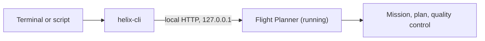

`helix-cli` is a command-line tool delivered with Flight Planner. It sends orders to the application while it is running: create a mission, add a zone, set the flight parameters, compute the plan, run the quality check, export. Each action is a **tool**, and each tool is a command. There are 31 of them.

## What it is for

- Chain the steps of a mission in a script and replay them as often as needed.
- Apply the same operation to many missions, for example export them all.
- Read the state of the application (active flight, parameters, plan summary) from another program.
- Let an AI assistant such as Claude Desktop or Cursor drive the application. See [AI assistants](/cli/mcp/assistants-ia).

## How it works

The command line does not open a planning engine of its own. It **drives the application you have already launched and signed in to**. The planning, the terrain and the license are those of the running Flight Planner.

An action sent from the command line behaves like a gesture in the interface:

- the change appears on screen, and the mission view comes forward if a mission is open;
- the change can be undone, from the interface or with the [`history`](/cli/reference/elements-et-geometrie#history) tool;
- the change is saved with the mission.

The command line reaches the application through a small server built into it. This server listens on the local machine only (`127.0.0.1`), requires an access token, and refuses requests that do not come from the local machine. You never type the port or the token: `helix-cli` reads them from a file that the application publishes in its data folder.

## What you need

- Flight Planner **running**, with a **session open** (you are signed in in the application).
- The **Pro** plan, which includes the command line (and the MCP bridge for AI assistants).
- `helix-cli` installed on the computer.

The details are in [Requirements and license](/cli/demarrage/prerequis-et-licence).

## The pages of this section

<CardGroup cols={2}>
  <Card title="Requirements and license" href="/cli/demarrage/prerequis-et-licence" icon="key">
    What must be in place, and what happens without the license.
  </Card>
  <Card title="Installation" href="/cli/demarrage/installation" icon="download">
    Windows and macOS, and how to check that it works.
  </Card>
  <Card title="First commands" href="/cli/demarrage/premieres-commandes" icon="play">
    List the tools, read a tool's help, make a first call.
  </Card>
  <Card title="Arguments" href="/cli/utilisation/arguments" icon="code">
    How to write values, lists, points and objects.
  </Card>
  <Card title="Output and exit codes" href="/cli/utilisation/sorties-et-codes-de-retour" icon="list-check">
    Read the result and the errors, and use the command in a script.
  </Card>
  <Card title="Command reference" href="/cli/reference/missions-et-vols" icon="book">
    The 31 tools, grouped by theme.
  </Card>
  <Card title="AI assistants" href="/cli/mcp/assistants-ia" icon="plug">
    The MCP bridge for Claude Desktop, Cursor and others.
  </Card>
  <Card title="Worked examples" href="/cli/exemples/scenarios" icon="route">
    Complete scenarios from the first command to the export.
  </Card>
</CardGroup>

If a command fails, go to [Troubleshooting](/cli/aide/depannage).

## The command reference at a glance

| Page | Tools |
|---|---|
| [Missions and flights](/cli/reference/missions-et-vols) | `app_status`, `missions_list`, `mission_load`, `mission_create`, `flights_list`, `flight_add`, `flight_select`, `flight_configure`, `equipment_list` |
| [Elements and geometry](/cli/reference/elements-et-geometrie) | `mission_geometry`, `element_select`, `element_add`, `element_delete`, `element_rename`, `vertex_move`, `obstruction_add`, `history` |
| [Planning](/cli/reference/planification) | `params_get`, `params_set`, `plan_compute`, `plan_get` |
| [Quality control](/cli/reference/controle-qualite) | `qc_compute`, `qc_view` |
| [Camera, terrain and layers](/cli/reference/camera-terrain-et-couches) | `camera_get`, `camera_set`, `camera_frame`, `terrain_at`, `layers_set` |
| [Import and export](/cli/reference/import-et-export) | `kml_import`, `obstructions_import`, `mission_export` |
