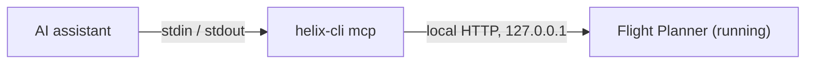

AI assistants such as Claude Desktop or Cursor speak **MCP** (Model Context Protocol). With the MCP bridge of `helix-cli`, such an assistant can use the same 31 tools as the command line: read the state of the mission, add a zone, set the parameters, compute the plan, run the quality check, export.

## How it works

The command `helix-cli mcp` is a bridge. The assistant starts it as a program, writes MCP messages to it (one JSON line per message on its standard input), and reads the answers (on its standard output). The bridge forwards each message to Flight Planner, which must be running and signed in.



The bridge finds the port and the access token by itself, in the same file as the command line. **The configuration of the assistant contains no secret.** If you restart the application while the assistant is open, the bridge reads the file again at the next failure.

## Requirements

- Flight Planner running, with a session open.
- The **Pro** plan, which includes MCP. See [Requirements and license](/cli/demarrage/prerequis-et-licence).
- `helix-cli` installed and reachable. See [Installation](/cli/demarrage/installation).

## Configure the assistant

<Steps>
  <Step title="Copy the configuration from the Settings">
    In Flight Planner, open the **Settings**, then the **Server** section. In the **MCP server (AI agent)** card, on the **Access** row, click **Copy AI config**. The message **MCP configuration copied.** confirms the copy.
  </Step>
  <Step title="Paste it into your assistant">
    Paste the text into the MCP servers configuration of your assistant, in the place its documentation indicates.
  </Step>
  <Step title="Restart the assistant">
    Restart the assistant if it asks for it. The `helix` server appears with its tools.
  </Step>
</Steps>

The copied text is the following configuration. You can also type it yourself:

```json
{"mcpServers":{"helix":{"command":"helix-cli","args":["mcp"]}}}
```

- `helix` is the name under which the assistant lists the server.
- `command` and `args` start `helix-cli mcp`.

<Tip>
If the assistant says it cannot start `helix-cli`, put the full path of the command in `command` (on Windows, the path of `helix-cli.exe` shown in [Installation](/cli/demarrage/installation)).
</Tip>

## The card in the Settings

The **MCP server (AI agent)** card is in **Settings**, **Server** section. It shows:

- **Status**: **Running** (with the local address and the number of requests), **Stopped**, **Stopped in Settings**, **MCP or CLI add-on required**, or **Error** with its code. The **Start** or **Stop** button and the **Restart** button act on the server.
- **Access**: `MCP ✓ · CLI ✓` according to your license, and the **Copy AI config** button.

The note under **Status** reminds you that the server starts with the application, on the local machine only (127.0.0.1).

## What the assistant sees

- **The tools:** the 31 tools of the [command reference](/cli/reference/missions-et-vols), with their description (in English) and the schema of their arguments. Tools that only read are marked as such.
- **A usage hint:** the server tells the assistant the typical order of use: list the missions, open one, read its geometry, select or add an element, set the parameters, compute the plan, run the quality check. Distances are in meters, angles in degrees, coordinates in WGS84, and the tools act on the active element.
- **Errors it can read:** when a tool fails, the assistant receives the text `CODE: message`, flagged as an error, so that it can correct its call. A tool that does not exist is reported as a protocol error.
- **Progress:** for long operations (plan, quality check), an assistant that asks for it receives progress notifications.

The versions of the protocol accepted are `2025-06-18`, `2025-03-26` and `2024-11-05`.

<Warning>
An assistant acts on your mission **as you would**: the changes appear on screen, are saved with the mission, and are added to the history. It can add, move and delete elements. Undo them with **Ctrl+Z** in the application, or with the [`history`](/cli/reference/elements-et-geometrie#history) tool.
</Warning>

## Without the MCP right

If your license includes the command line but not MCP, the application refuses **every** message, from the initialization of the session. The assistant receives an error whose message is:

```text
add-on addon.mcp requis par la licence
```

If the application is closed, the assistant receives an error with the message `AERO Flight Planner n'est pas lancé, ou son serveur MCP est arrêté (Réglages → Serveur)`, followed by the files that were searched.

These messages are written in French, whatever the language of the application.

## Test the bridge by hand

You can check the bridge without an assistant. Send it a `ping`:

```sh
echo '{"jsonrpc":"2.0","id":1,"method":"ping"}' | helix-cli mcp
```

The bridge answers with one JSON-RPC line whose `result` is empty, then stops when its input ends. To see the list of the tools, send `{"jsonrpc":"2.0","id":2,"method":"tools/list"}` in the same way.

## See also

- [First commands](/cli/demarrage/premieres-commandes)
- [Troubleshooting](/cli/aide/depannage)
