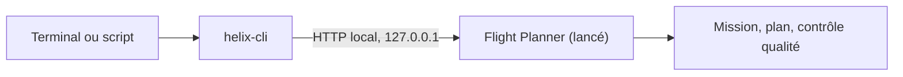

`helix-cli` est un outil en ligne de commande livré avec le Flight Planner. Il envoie des ordres à l'application pendant qu'elle tourne : créer une mission, ajouter une zone, régler les paramètres de vol, calculer le plan, lancer le contrôle qualité, exporter. Chaque action est un **outil**, et chaque outil est une commande. Il y en a 31.

## À quoi elle sert

- Enchaîner les étapes d'une mission dans un script et les rejouer autant de fois que nécessaire.
- Appliquer la même opération à de nombreuses missions, par exemple les exporter toutes.
- Lire l'état de l'application (vol actif, paramètres, résumé du plan) depuis un autre programme.
- Laisser un assistant IA comme Claude Desktop ou Cursor piloter l'application. Voir [Assistants IA](/fr/cli/mcp/assistants-ia).

## Comment elle fonctionne

La ligne de commande n'ouvre pas de moteur de planification à elle. Elle **pilote l'application que vous avez déjà lancée et dans laquelle vous êtes connecté**. Le calcul, le terrain et la licence sont ceux du Flight Planner en cours d'exécution.

Une action envoyée depuis la ligne de commande se comporte comme un geste dans l'interface :

- la modification apparaît à l'écran, et la vue de la mission passe au premier plan si une mission est ouverte ;
- elle peut être annulée, depuis l'interface ou avec l'outil [`history`](/fr/cli/reference/elements-et-geometrie#history) ;
- elle est enregistrée avec la mission.

La ligne de commande joint l'application par un petit serveur intégré. Ce serveur n'écoute que sur la machine locale (`127.0.0.1`), exige un jeton d'accès et refuse les requêtes qui ne viennent pas de la machine locale. Vous ne saisissez jamais le port ni le jeton : `helix-cli` les lit dans un fichier que l'application publie dans son dossier de données.

## Ce qu'il faut

- Le Flight Planner **lancé**, avec une **session ouverte** (vous êtes connecté dans l'application).
- Le **plan Pro**, qui inclut la ligne de commande (et le pont MCP pour les assistants IA).
- `helix-cli` installé sur l'ordinateur.

Le détail se trouve dans [Prérequis et licence](/fr/cli/demarrage/prerequis-et-licence).

## Les pages de cette section

<CardGroup cols={2}>
  <Card title="Prérequis et licence" href="/fr/cli/demarrage/prerequis-et-licence" icon="key">
    Ce qui doit être en place, et ce qui se passe sans la licence.
  </Card>
  <Card title="Installation" href="/fr/cli/demarrage/installation" icon="download">
    Windows et macOS, et comment vérifier que tout fonctionne.
  </Card>
  <Card title="Premières commandes" href="/fr/cli/demarrage/premieres-commandes" icon="play">
    Lister les outils, lire l'aide d'un outil, faire un premier appel.
  </Card>
  <Card title="Arguments" href="/fr/cli/utilisation/arguments" icon="code">
    Comment écrire les valeurs, les listes, les points et les objets.
  </Card>
  <Card title="Sorties et codes de retour" href="/fr/cli/utilisation/sorties-et-codes-de-retour" icon="list-check">
    Lire le résultat et les erreurs, et utiliser la commande dans un script.
  </Card>
  <Card title="Référence des commandes" href="/fr/cli/reference/missions-et-vols" icon="book">
    Les 31 outils, regroupés par thème.
  </Card>
  <Card title="Assistants IA" href="/fr/cli/mcp/assistants-ia" icon="plug">
    Le pont MCP pour Claude Desktop, Cursor et d'autres.
  </Card>
  <Card title="Exemples" href="/fr/cli/exemples/scenarios" icon="route">
    Des scénarios complets, de la première commande à l'export.
  </Card>
</CardGroup>

Si une commande échoue, rendez-vous dans [Dépannage](/fr/cli/aide/depannage).

## La référence en un coup d'œil

| Page | Outils |
|---|---|
| [Missions et vols](/fr/cli/reference/missions-et-vols) | `app_status`, `missions_list`, `mission_load`, `mission_create`, `flights_list`, `flight_add`, `flight_select`, `flight_configure`, `equipment_list` |
| [Éléments et géométrie](/fr/cli/reference/elements-et-geometrie) | `mission_geometry`, `element_select`, `element_add`, `element_delete`, `element_rename`, `vertex_move`, `obstruction_add`, `history` |
| [Planification](/fr/cli/reference/planification) | `params_get`, `params_set`, `plan_compute`, `plan_get` |
| [Contrôle qualité](/fr/cli/reference/controle-qualite) | `qc_compute`, `qc_view` |
| [Caméra, terrain et couches](/fr/cli/reference/camera-terrain-et-couches) | `camera_get`, `camera_set`, `camera_frame`, `terrain_at`, `layers_set` |
| [Import et export](/fr/cli/reference/import-et-export) | `kml_import`, `obstructions_import`, `mission_export` |
